<div align="center">

# `CHARAN GOWDA M D: ~`

<!-- Top: Animated 53-Week GitHub Contribution Heatmap -->
<a href="https://github.com/charangowdamd-cmd">
  
</a>

<br/><br/>

<!-- Side-by-Side: Animated ASCII Portrait & Neofetch Information Card -->
<table>
  <tr>
    <td width="48%" align="center" valign="top">
      
    </td>
    <td width="52%" align="center" valign="top">
      
    </td>
  </tr>
</table>

</div>

---

### `~/terminal/session.log`

```bash
charan@svit:~$ whoami
Charan Gowda M D — Computer Science Engineering Student @ Sai Vidya Institute of Technology, Bengaluru

charan@svit:~$ cat ~/profile/current_focus.md
• Engineering resilient backend architectures and distributed data systems.
• Actively contributing to Apache Software Foundation projects (Apache Maven core, Apache Gravitino).
• Leading developer initiatives at SVIT Open Source Software (OSS) Club.

charan@svit:~$ ./list-repositories.sh --starred
• Salamander         - Fullstack coding platform & technical interview preparation suite
• BEL-Blockchain     - Defense Blockchain Secure Platform MVP (Bharat Electronics Limited)
• maven              - Contributing pull requests and bug fixes to Apache Maven core
• entire-graph       - Entity-level semantic checkpoint context plugin for CLI tooling

charan@svit:~$ ./connect.sh
• GitHub:    https://github.com/charangowdamd-cmd
• LinkedIn:  https://www.linkedin.com/in/charan-gowda-m-d-8b3318340
• Focus:     Backend Engineering & Systems
```

<div align="center">
  <sub>Automated daily via GitHub Actions • Rendered with pure SVG &amp; CSS keyframe animations</sub>
</div>
